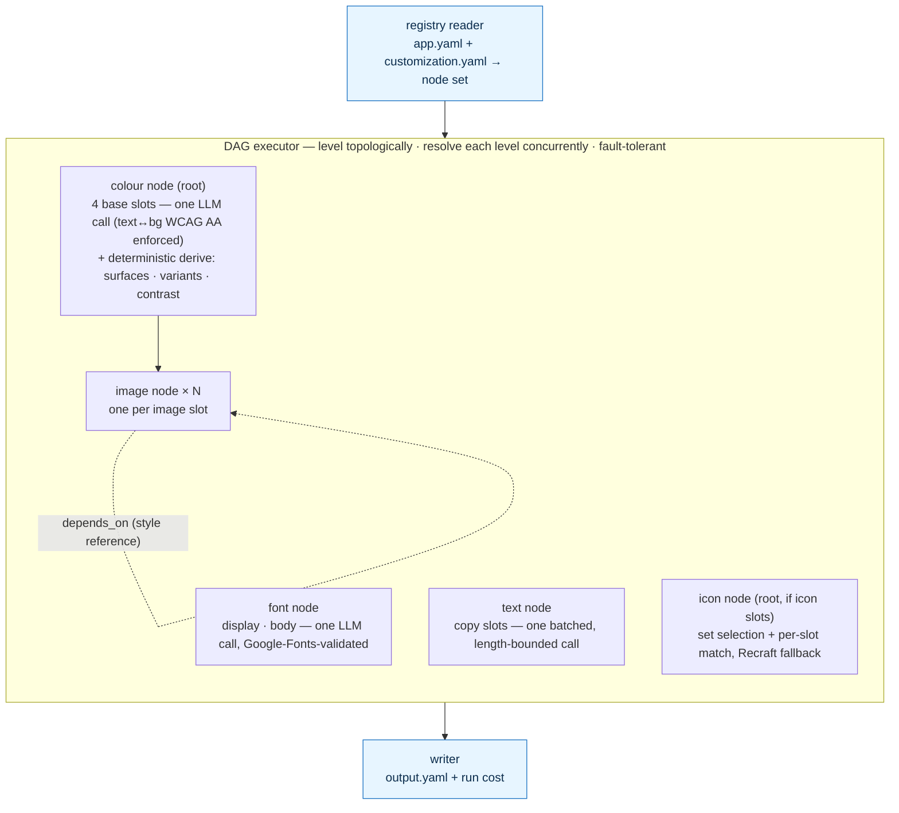

# ThemeTree Architecture

How CombatDen turns a brand brief into a customized mobile app.

Concepts touched: [[Concepts/Product/Mechanisms/Orchestrator|Orchestrator]], [[Concepts/Product/Mechanisms/Modal_Coherence|Modal_Coherence]], [[Concepts/Product/Mechanisms/Tokenized_Design_System|Tokenized_Design_System]]

> [!note] This describes the pipeline as shipped
> An earlier version of this doc described a much larger design: a five-stage sequential pipeline producing a `TenantCustomization` document with six override pillars resolved through a page → flow → tenant cascade. That *resolution architecture* was ambitious — and likely overengineered. The pipeline that actually shipped is far simpler and works fine as it is. The decision is recorded in [[pivots/2026-05-20-23-customization-pipeline-simplified-to-dependency-dag|pivots/2026-05-20-23-customization-pipeline-simplified-to-dependency-dag.md]]. Governing principle for the architecture: **add complexity only as it is required.** Note this applies to the machinery, not the surfaces — **animation and icon-set modification stay in the modification pipeline**; they are committed and scheduled for after validation (see Next on the timeline).

---

## The product question this answers

Every gym should look like *their* gym, not a templated app with a swapped logo. Doing that by hand for every tenant is impossible at scale, so the AI Gen pipeline takes a brand brief and produces a customized app end-to-end.

Today the customized surface is **images, colours, fonts, text, and icons**. Icons joined the DAG as a root node (set selection + per-slot match against a curated set, generating any the set can't cover, Recraft fallback) — only animation remains uncustomized (see below). The architecture is intentionally composed of boring, well-known patterns; boring patterns ship and weird patterns don't. The novel piece is the application — brand brief → customized production mobile app — not the machinery.

---

## Two inputs, one output

The pipeline lives in `ThemeTree/`, and the read API that serves the produced `output.yaml` to every client — `theme.combatden.net` — is `Backend/`. See the root `README.md`. It takes **two YAMLs** and produces **one**:

- **`app.yaml`** — the *app format*. Architect-owned. Declares the slot inventory: every slot name, its description, and the image→image `depends_on` edges. This is what makes the pipeline app-agnostic — the pipeline code knows nothing about any specific app; point it at a different `app.yaml` and it customizes a different app, no code changes.
- **`customization.yaml`** — the *brand brief*. The only brand-authored surface. Five fields: `design_direction.name`, `short_desc`, `long_desc`, and `colors_direction.description` + `mode` (light/dark). It is *intent*, never *values* — it says what the brand feels like and which way colour should lean; the pipeline decides the exact numbers.
- **`output.yaml`** — what the pipeline produces: a resolved palette plus the resolved image, font, and text slots, with a total run cost.

Both live under `apps/<app_id>/`. Every new app is one new folder.

### The brand-brief skill

`customization.yaml` is authored by a dedicated Claude skill, **`brand-brief`** (`.claude/skills/brand-brief/`). It runs a lean, question-driven interview — about ten high-leverage questions, one at a time, every one a multiple-choice `AskUserQuestion` — grounded in the chosen app's real `app.yaml` slots. It weights questions toward brand identity and keeps colour at the mood / hue-family / saturation / mode level (never hex or OKLCH), because the pipeline owns precise colour values under rules a hardcoded colour would fight. It assembles the YAML, round-trips it against the `Customization` Pydantic model, and writes it only after explicit approval. It authors *only* `customization.yaml` — never `app.yaml` or pipeline code.

---

## The pipeline is a dependency DAG

Not a fixed sequence — a **dependency DAG**. The registry turns the two YAMLs into a node set, and the executor levels that graph topologically and resolves each level **concurrently**.

The node set is: **one colour node, one font node, one text node, one icon node (when the app declares icon slots), and one image node per image slot.** Colour, font, text, and icon are the level-0 roots and run side by side. Every image node depends on the colour node (it needs the resolved palette). The font, text, and icon nodes have no dependents. An image slot may also declare `depends_on` other image slots — used purely for **visual continuity**: the dependency's resolved look is folded into this slot's prompt as a style reference, never fed in as an input image.

The graph is validated (acyclic, every dependency satisfied) **before any paid call**. The run is then **fault-tolerant**: a node that fails skips only its transitive dependents — every other slot still resolves and is written. The writer assembles whatever resolved into `output.yaml` and totals the run cost.

### Per-node behavior

**Colour** — one paid call, the rest derived. The single LLM call resolves only the **four base slots** (`primary`, `background`, `text`, `accent`) as OKLCH, under a contract checked before the result is accepted: `text` clears WCAG AA (4.5:1) on `background`, text lightness is pinned by mode, base colours stay low-chroma. Everything else — elevated card/popup surfaces, faded secondary/tertiary tints, dividers, dark/light variants, the background-lightness safe band — is computed **deterministically in Python**, no extra LLM calls. The run emits one flat, ready-to-consume palette. This is what lets the client become a plain consumer; the surface math each client used to carry is gone.

**Font** — one Google-Fonts-validated call (display + body). A pick that isn't a real Google Fonts family rides the retry loop.

**Text** — one batched, length-bounded call rewriting every copy slot. A slot that lands outside its word/character bounds is re-asked, then dropped so the client falls back to its bundled copy.

**Icon** — set selection (pick a curated icon set) plus per-slot matching against it, with a Recraft generation fallback for any slot the set can't cover.

**Image** — each node resolves one image end to end: build prompt (brief + slot + palette + any declared dependencies as style reference) → classify visual complexity → quality tier → generate (text-to-image only) → background pass (remove flat backdrop → grid-trim crop). There is no style-adherence check and no corrective edit — they were removed as extra paid calls for marginal gain.

> Provider choices are architecture, not pipeline logic. Each call's model id is a per-call constant at the top of the module that makes the call, not a config/env knob; only secrets (API keys) live in `config.py`. Image generation goes through a generic litellm generator, so swapping the image model is a one-line change. Cost is estimated from litellm's own per-response pricing.

---

## Correction loop

Coherence is achieved **structurally**, not by a separate review stage — the shared derived palette feeds every image prompt, `depends_on` edges fold one slot's look into another's prompt, and colour derivation is deterministic. See [[Concepts/Product/Mechanisms/Modal_Coherence|Modal_Coherence]]. There is no VLM self-critique pass; it can worsen already-good output and isn't needed at the current surface.

When something does need correcting, the user re-runs the relevant node(s). The user is a better judge of brand fit than a model — this matches how every shipped competitor (Gamma, Beautiful.ai, Synthesia, Webflow AI) handles correction.

---

## The runtime client

The Flutter apps are **white-label / templated**: one codebase reskinned per tenant. The engine that reads `output.yaml` and resolves slots at runtime lives in the shared **`Flutter`** package (not inside `MobileApp/`) — both MobileApp and CRM import it — via `ThemeColor`, `ThemeFont`, `ThemeText`, `ThemeImage`, `ThemeIcon`. Because the pipeline now ships a finished palette, the client is a plain consumer and no longer derives elevation/divider/popup math itself.

> [!info] One asymmetry worth knowing: images have no engine fallback
> Colours, fonts, and text each fall back to a bundled const default (the CombatDen palette/copy) when no customization is loaded. **Images deliberately do not.** The image resolver returns `null` whenever no customization applies — DI not set up, nothing loaded, slot absent, or empty URL — and the app-side branded-image widget pairs that `null` with the tenant's bundled asset. A built-in image fallback was skipped because resolving local-asset-vs-network-URL made it materially more complex than the colour/font/text case. Keeping the engine a pure live override (and letting the bundled tenant asset be the fallback) was the simpler, working choice — consistent with the add-complexity-only-as-needed principle.

---

## Next on the timeline

The simpler pipeline is the floor, not the ceiling. Icon-set modification has since shipped as a DAG root node (see **Icon** above). **Animation modification** is the remaining committed surface — it stays in the modification pipeline, scheduled for **after validation** (validate the business first, then build it), not gated on "only if a need arises." It would join the DAG as a new node type for branded motion; a curated, tagged Lottie library with brand recoloring was the earlier reference design, but the Lottie module itself has since been removed from the codebase (Lottie is gone everywhere except one bundled MobileApp checkmark animation), so this surface would need a fresh design pass rather than resuming the old module.

The "add complexity only as required" principle governs the *resolution architecture* (cascade, per-page overrides, self-critique) — not these surfaces, which are planned roadmap.

---

## Schema and runtime contract

The schema (`schema/`, Pydantic v2) is shape-only: no I/O, no network code. It defines the contracts for `app.yaml`, `customization.yaml`, and `output.yaml` (palette with `mode`, image/font/text outputs, run cost). Detailed schema layout and per-class rules are canonical in the codebase — don't duplicate them here; drift is the failure mode.

---

## See also

- `README.md` — the authoritative pipeline walkthrough with the worked `combatden` run.
- `schema/` — the Pydantic contracts for the three YAMLs.
- `.claude/skills/brand-brief/` — the skill that authors `customization.yaml`.
- `apps/combatden/` — a worked example (`app.yaml`, `customization.yaml`, runs).
- `Flutter/` — the shared Flutter engine that consumes `output.yaml`, imported by both the member app and the CRM.
- [[pivots/2026-05-20-23-customization-pipeline-simplified-to-dependency-dag|pivots/2026-05-20-23-customization-pipeline-simplified-to-dependency-dag.md]] — why the pipeline is this shape and not the six-pillar orchestrator.
